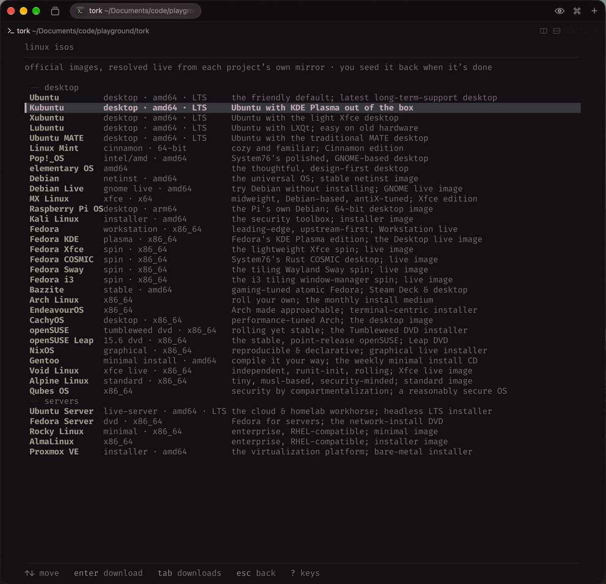

# tork

Search torrents, choose your files, and manage downloads from your terminal.

Search several indexes at once, compare sizes and seeders, and preview files
before starting a download. Matching torrents from different indexes share one
row and combine their trackers. Official Linux images have their own browser.



[Install](#install) · [Get started](#get-started) · [Keys](#keys) ·
[Search sources](#search-sources) · [Configuration](#configuration) ·
[Troubleshooting](#troubleshooting) · [Build from source](#build-from-source)

## Install

### macOS (Homebrew)

```sh
brew tap melqtx/tap
brew install tork
```

### Arch Linux (AUR)

```sh
yay -S tork
```

### Nix

```sh
nix run github:melqtx/tork
```

### Go

Requires Go 1.26.10 or newer and a C compiler.

```sh
go install github.com/melqtx/tork/cmd/tork@latest
```

Make sure Go's binary directory is on your `PATH`. See
[Build from source](#build-from-source) to run the current code locally.

## Get started

```sh
tork
```

1. Type a search and press **Enter**.
2. Use **↑↓** to compare results. Check the size, source, and reported seeders.
3. Press **Enter** to preview. Use **Space** to choose files, then **Enter** to
   start the download.
4. Press **Ctrl+D** or **F3** to open Downloads. **F2** returns to your latest search.

These steps use the default preview setting. **D** on a result downloads it
without the preview. Seeder counts help compare results; they do not guarantee speed.

Already have a torrent? Paste a magnet, infohash, torrent URL, or local `.torrent`
path into the Home search field, or pass it on the command line:

```sh
tork 'magnet:?xt=urn:btih:…'
tork ./linux.iso.torrent
tork 'https://example.org/linux.iso.torrent'
tork --torrent-url 'https://example.org/download?id=123'
```

Downloads go to your OS Downloads folder under `tork`. To use another folder:

```sh
tork -d /path/to/downloads
```

### Keep transfers running

On **macOS and Linux**, closing the UI leaves approved downloads and seeding
running. Reopen `tork` to reconnect to the same session.

```sh
tork status    # show the background session status
tork stop      # save state and stop transfers; keep the files
```

Only one terminal can attach at a time. Transfers need the computer to stay
awake; tork does not install an OS startup service.

Use `tork --foreground` to stop transfers when the UI closes. Windows uses this
foreground behavior. Stop an existing background session before switching modes
or changing its download folder, proxy, or engine settings.

## Keys

Press **?** for all keys on the current screen.

| Key | Action |
| --- | --- |
| **↑↓** | Move through results or menu choices |
| **Enter** | Open the selection; confirm a preview to download |
| **Space** | Choose a file or folder in the preview |
| **Tab / Shift+Tab** | Move between Home controls or the results list and browse menu |
| **Ctrl+D / F3** | Open Downloads |
| **F1 / F2 / F4** | Home / latest results / Sources |
| **Esc** | Go back or cancel the current step |
| **Ctrl+C** | Close the UI |

Dialogs keep focus until you finish or cancel them. From Downloads, **Tab**, **Shift+Tab**,
or **Esc** returns to the previous screen.

In search results:

| Key | Action |
| --- | --- |
| **/** | Edit the search; Tab or Shift+Tab returns without submitting the draft |
| **f** | Filter the current results |
| **Ctrl+F** | Choose resolution, maximum size, and ranking preferences |
| **o** | Sort by relevance, seeders, or size |
| **z** | Hide results with no reported seeders |
| **r** | Reset filters while keeping the selected category |
| **s** | Check each source's outcome for this search |
| **Y** | Copy the selected magnet |
| **v / V** | Switch to resolution picks / release groups |

In Downloads, **p** pauses or resumes, **v** verifies completed files, **m** moves
them, and **r** relinks files already on disk. **y** copies the path, **Y** copies
the magnet, **x** removes the saved download, and **d** also deletes its files.

<details>
<summary>Advanced search filters</summary>

Press **f** and combine plain text with filters:

```text
ubuntu seeders:>5 size:<8gb
res:1080p,2160p codec:x265 -source:cam
provider:nyaa category:anime is:trusted
is:hdr -is:dv
```

Fields: `res`, `seeders`, `size`, `source`, `codec`, `provider`, and `category`.
Attributes: `is:trusted`, `is:hdr`, `is:dv`, and `is:pack`.
Use `-` before a filter to exclude matches. Size limits exclude unknown sizes.

</details>

## Search sources

Open **Sources** with **F4**. Knaben, YTS, and Nyaa are enabled by default.
The Pirate Bay, EZTV, 1337x, TheRARBG, and LimeTorrents are also built in.

- **Enter / Space:** enable or disable a source.
- **a:** add a source from the catalog; type its name to find it.
- **t:** test the selected source. **r:** recheck all enabled sources.

Changes save to your config and apply to the next search. Current results stay
usable. Adding more sources is optional; an upgrade keeps your existing choices.

Some sites block automated requests or become unavailable. Tork shows those
failures separately from an empty search. Blocked sources pause for ten minutes;
**t** retries immediately. Other sources keep working.

<details>
<summary>Add your own RSS or Torznab source</summary>

In Sources, press **a** and choose **Custom RSS / Torznab…**. Give it a name,
choose the type, and enter the endpoint. For Torznab, enter the API key in the
masked field. Jackett and Prowlarr can provide Torznab endpoints.

- **RSS:** the search URL needs `{query}` where the search text belongs.
- **Torznab:** use the API endpoint; tork adds the search parameters.
- **Ctrl+T:** test the draft. **Ctrl+S:** test and save.
- **e / x** in Sources: edit or remove a custom source.

Entries must include a valid v1 magnet or infohash. Private trackers and feeds
that only return `.torrent` download URLs are not supported. A normal website URL
is not an RSS search feed. If a check fails, fix the draft or follow the prompt to
save it disabled.

Custom-source saves keep the config private (`0600` on Unix). Keep API keys and
credential-bearing URLs out of shared configs.

</details>

## Configuration

Config lives in `~/.tork/config.yaml`. Common options, shown with their defaults:

```yaml
hide_linux_isos: false
preview_before_download: true
seed_after_complete: true
hide_nsfw: true
```

Set `hide_linux_isos: true` to hide Linux ISOs from Home. Set it to `false`, or
remove the line, to show them again. Set `seed_after_complete: false` to stop
seeding when a new download finishes.

Restart tork after editing the config. If it runs in the background, close the
UI and run `tork stop` first. To use a separate config and session:

```sh
tork --config-dir ./my-tork-config
```

### Download folders

New installs organize downloads automatically under your OS Downloads folder:
`tork/movies`, `tork/tv`, `tork/anime`, `tork/music`, `tork/games`,
`tork/software`, `tork/books`, and `tork/linux`. Unknown or conflicting source
categories use the main `tork` folder. An explicit `download_dir` stays the root.

Existing settings are preserved. Press **O** in Downloads to toggle automatic
folders for new downloads.

In preview, press **c** to choose a category, then **a** to add your own. The
folder defaults to the lowercase category name. Manual choices also work with automatic
organization off.

In Downloads, **f** filters by category. Select a download and press **c** to
change its category and move its files. Review the destination and press Enter
to confirm. Existing downloads keep their locations until you explicitly move
them, even after config changes.

Press **A** in Downloads to organize existing downloads. Review the proposed
folders, use **c** to correct categories, then press Enter to apply the moves.
Escape cancels the preview. Moves run in the background, preserve paused and
seeding settings, and refuse existing destinations. Interrupted moves recover
on restart; ambiguous file locations require relinking.

Folder mappings can also be set in `~/.tork/config.yaml`:

```yaml
organization:
  enabled: true
  folders:
    movies: Films
    Courses: Learning
```

Folder paths must stay inside `download_dir`. Config edits apply after restarting
tork; changes made through the UI apply immediately.

### SOCKS5 proxy

For a local Tor proxy:

```sh
tork proxy tor
tork proxy status
tork doctor --proxy-check
```

Or set your own endpoint:

```sh
tork proxy set socks5://127.0.0.1:1080
```

For credentials, run `tork proxy set` without the URL and use the hidden prompt.
Both `socks5://` and `socks5h://` resolve names through the proxy. Use
`tork proxy off` to disable it; restart the background session after changes.

Proxy mode uses the configured route for searches and downloads and fails closed.
It disables DHT, uTP, UDP trackers, incoming peers, UPnP, and WebTorrent, which can
reduce peer availability. A proxy is not a guarantee of anonymity. The Tor badge
appears only after a live exit check; a failed check is shown as unavailable.

<details>
<summary>Cache, direct downloads, torrent limits, and health checks</summary>

These settings are optional. Edit only the ones you need.

```yaml
metadata_cache:
  enabled: true
  max_mb: 256
  max_entries: 512

direct:
  max_connections: 4
  min_chunk_size: "10MB"
  enable_chunking: true

health:
  enabled: false
  interval_hours: 24
```

The metadata cache avoids finding the same torrent metadata again. Direct HTTP
downloads use parallel byte ranges when supported and fall back to one connection
otherwise. Published checksums, when available, are checked before the final file
is accepted. **v** in Downloads rechecks completed torrent pieces or direct-file
checksums. Mismatches are moved aside with a `.corrupt` suffix before retrying.

Advanced torrent overrides use zero or omitted values to keep library defaults:

```yaml
torrent_tuning:
  half_open_conns_per_torrent: 25
  total_half_open_conns: 100
  piece_hashers_per_torrent: 2
  max_unverified_bytes: 67108864
  dial_rate_limit: 10
  peer_high_water: 500
  peer_low_water: 50
  download_rate_limit: 0
  upload_rate_limit: 0
  disable_aggressive_upload: false
  no_upload: false
```

Rate limits are client-wide bytes per second; dial rate is dials per second.
`no_upload: true` also prevents seeding.

Automatic health checks are off by default. Enabling them sends the generic
`1080p` canary to enabled sources when the saved check is old enough. **H** opens
saved health history. Health data stays local.

</details>

<details>
<summary>Autopilot (experimental)</summary>

Autopilot turns a request into a reviewable download plan. Start with a dry run:

```sh
tork autopilot --dry-run --min-seeders 5 --max-size 8GB "ubuntu amd64"
```

Use `-n N` to limit picks and `--category` to narrow content categories. Without
`--dry-run`, tork asks before queueing. `--headless` skips the UI; scripts also
need `--yes` to skip confirmation. Flags override request text, which overrides
config defaults. Plans are recorded locally in `~/.tork/autopilot.jsonl`.

```yaml
autopilot:
  max_downloads: 3
  min_seeders: 10
  max_size_gb: 40
  allowed_categories: [movies, anime]
```

</details>

## Troubleshooting

Start with `tork doctor`. It reads your setup and checks config, disk, state,
metadata, and source reachability. It does not repair or rewrite files by default.
Add `--record` to save a health report, `--engine` to test the torrent listener,
or `--proxy-check` to check the proxy's exit route.

| Problem | Try this |
| --- | --- |
| No results | Press **s** in results, or **t** in Sources, to see which index failed. Check that at least one source is enabled. |
| A source says blocked | Try another enabled source. **t** retries the blocked source; this does not bypass site protection. |
| Transfers continue after quitting | On macOS/Linux, use `tork stop` to stop the background session. |
| A rebuilt binary finds an older worker | Close the UI, run `tork stop`, then open the new binary. |
| Preview is waiting for metadata | Wait for a peer, use a `.torrent` file, or press Enter to queue the whole torrent. |

For Go installs on macOS that accidentally pick Nix's compiler, use Apple Clang:

```sh
CC=/usr/bin/clang CXX=/usr/bin/clang++ go install github.com/melqtx/tork/cmd/tork@latest
```

When reporting a bug, include `tork --version`, your OS and terminal, the steps to
reproduce it, and any relevant source status. Remove credentials from logs.

## Build from source

Requires Go 1.26.10+ and a C compiler.

```sh
git clone https://github.com/melqtx/tork.git
cd tork
go build -o ./bin/tork ./cmd/tork
./bin/tork
```

For a local test that uses its own config and stops when you exit:

```sh
./bin/tork --foreground --config-dir ./tmp/local-test
```

To check a change:

```sh
go vet ./...
go test -race -timeout 5m ./...
```

Live metadata-only source checks are opt-in and do not start downloads:

```sh
TORK_LIVE_SOURCES=1 go test ./internal/sources -run '^TestLiveBuiltinSources$' -v -count=1
```

## License

[MIT](LICENSE). Tork does not host files or control third-party indexes.
Only download and share files you have permission to use.
